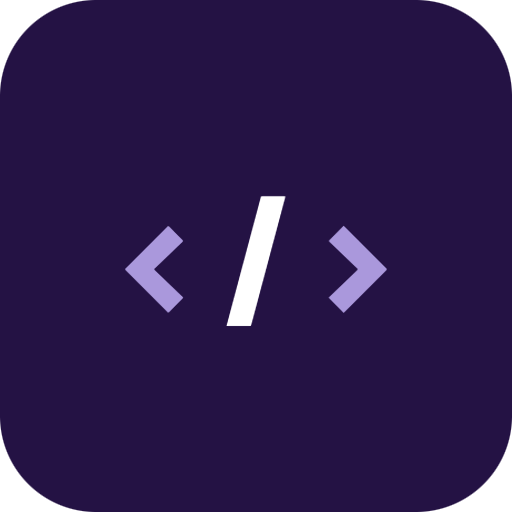
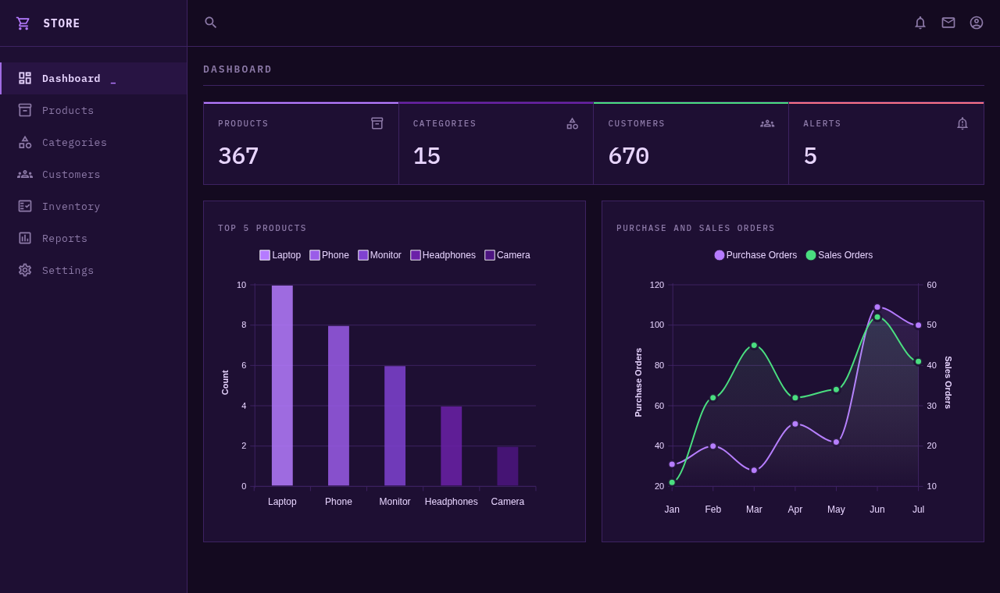
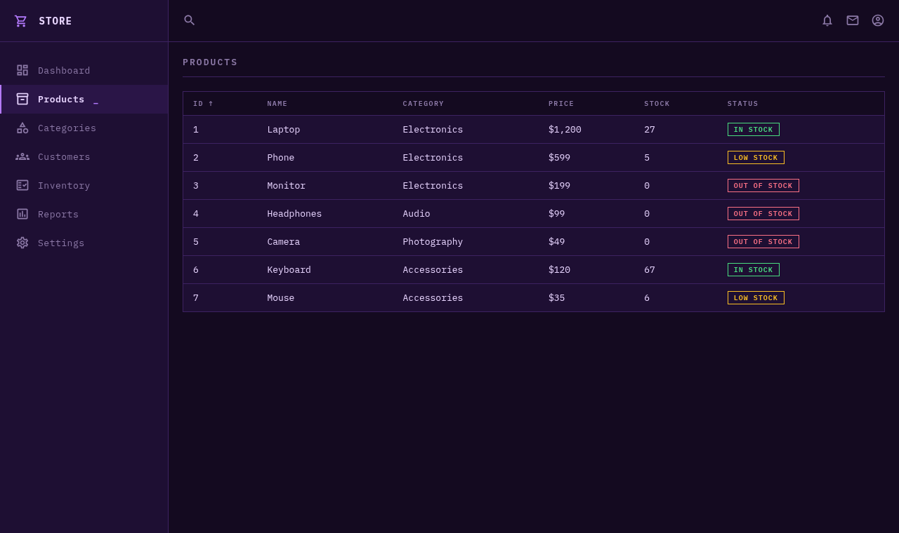
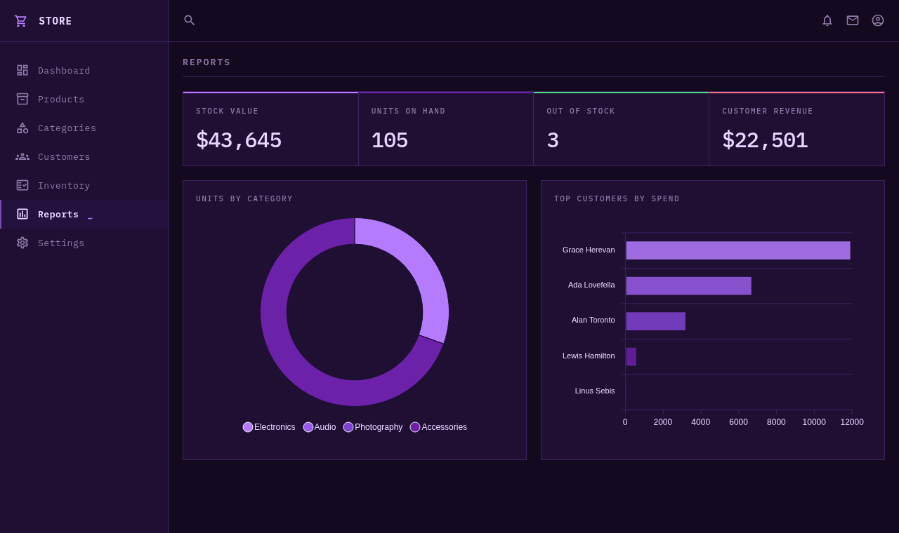
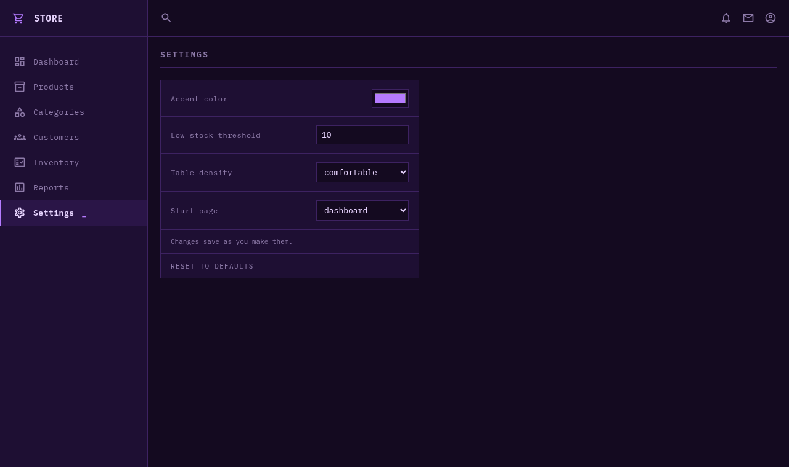

<div align="center">



# Aub Dashboard

**A responsive admin dashboard for sales & inventory.**<br/>
Vanilla JS, client-side routing, and ApexCharts - no build step.

<br/>

[](https://armd.one/Aub-Dashboard/)


[Features](#-features) &nbsp;•&nbsp;
[Pages](#-pages) &nbsp;•&nbsp;
[Getting Started](#-getting-started) &nbsp;•&nbsp;
[How It Works](#-how-it-works) &nbsp;•&nbsp;
[Roadmap](#-roadmap)

<br/>



</div>

<br/>

## ✨ Features

| | Feature | What it does |
|:-:|---|---|
| 📱 | **Responsive layout** | CSS Grid dashboard that collapses to a mobile sidebar |
| 🧭 | **Client-side routing** | Hash links swap the main view without a page reload, so refresh and the back button keep your place |
| 📊 | **Live charts** | Bar, area, and donut charts powered by ApexCharts that follow the accent color |
| 🗂️ | **Data-driven tables** | Products, Categories, Customers, and Inventory render from JS data arrays with colored status badges |
| ↕️ | **Sortable columns** | Click a header, or focus it and press <kbd>Enter</kbd>, to sort ascending or descending |
| 📈 | **Reports** | Stock value, units on hand, and customer revenue computed from the data |
| 🎨 | **Settings** | Accent color, low stock threshold, table density, and start page, saved to `localStorage` |
| ⚡ | **Zero build step** | Plain HTML, CSS, and JavaScript; no bundler, no dependencies to install |

## 🖼️ Pages

<table>
  <tr>
    <td width="50%" align="center">
      
      <br/>
      <b>Products</b>
      <br/>
      <sub>Sortable table with stock status badges</sub>
    </td>
    <td width="50%" align="center">
      
      <br/>
      <b>Reports</b>
      <br/>
      <sub>Totals and charts computed from the data</sub>
    </td>
  </tr>
  <tr>
    <td width="50%" align="center">
      
      <br/>
      <b>Settings</b>
      <br/>
      <sub>Saved as you change them</sub>
    </td>
    <td width="50%" align="center">
      
      <br/>
      <b>Dashboard</b>
      <br/>
      <sub>Summary cards and order charts</sub>
    </td>
  </tr>
</table>

## 🚀 Getting Started

No build tools required - just serve the files.

```bash
git clone https://github.com/aubergine-ux/Aub-Dashboard.git
cd Aub-Dashboard
```

Then open `index.html` directly, or run a local server:

```bash
python -m http.server 8000
# visit http://localhost:8000
```

## 🧱 Tech Stack

- HTML5 & CSS3 (Grid + custom properties)
- Vanilla JavaScript (ES6, no framework)
- [ApexCharts](https://apexcharts.com/) for data visualization
- Material Icons & IBM Plex Mono via Google Fonts

## 📁 Project Structure

```
.
├── index.html           # Layout: header, sidebar, cards, chart containers
├── css/
│   └── style.css        # Tokens, grid layout, responsive rules, table & badge styles
├── js/
│   └── scripts.js       # Routing, settings, sortable tables, reports, chart rendering
└── images/
    ├── favicon.png
    └── screenshots/     # README images
```

## 🔧 How It Works

Each sidebar link points at a hash like `#products`. A `hashchange` listener calls `route()`, which hands the page to `showPage()` to swap `#main`'s content - restoring the saved dashboard markup (and re-rendering the charts) or building a table from the `views` config.

Every view lists its rows and columns, and `table()` turns them into markup via `.map().join('')`:

```js
customers: {
  rows: () => customers,
  cols: [
    { key: 'id', label: 'ID' },
    { key: 'name', label: 'Name' },
    { key: 'email', label: 'Email' },
    { key: 'orders', label: 'Orders' },
    { key: 'spent', label: 'Total Spent', cell: (c) => money(c.spent) },
  ],
},
```

Adding a page is one more entry in `views` and one more link in the sidebar.

### Settings

| Setting | Default | Effect |
|---|---|---|
| Accent color | `#b57bff` | Recolors the UI and the charts |
| Low stock threshold | `10` | Stock below this shows a **Low Stock** badge |
| Table density | `comfortable` | `compact` tightens table rows |
| Start page | `dashboard` | The page shown when no hash is in the URL |

## 🗺️ Roadmap

- [x] Sortable table columns
- [x] Fill in Customers, Inventory & Reports views
- [ ] Search bar to filter products
- [ ] Dark / light theme toggle
- [ ] Connect to a live API

## 📄 License

Released under the [MIT License](LICENSE).

---

<div align="center">

If you found this useful, consider giving it a ⭐

</div>
